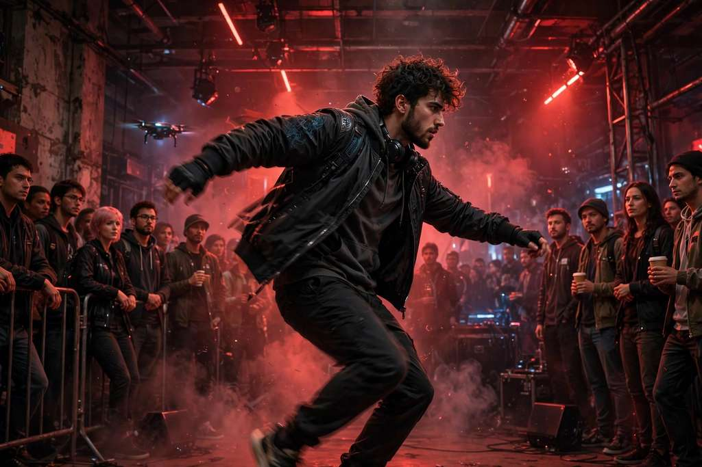

# Smalltown Boy AI Video Generator

**Your face. Your favorite co-star. A dramatic close-up, a role swap, a dance together.**

两张照片 → smalltown boy 双人 AI 短片 · 11 秒 · 768p · 按次付费

From **$4.99** · no subscription

Independent AI video fan tool. Upload only photos you have the rights to. AI results can vary in likeness, motion and detail — concept artwork on this page illustrates the idea, not a guaranteed result.

## Links

|  | URL |
| --- | --- |
| **App** | https://smalltownboyai.online |
| **This landing** | https://majiatools.github.io/smalltown-boy-ai/ |

## What it does

- **2 photos (Performer A + Performer B)** → a duo performance: A takes the dramatic close-up while B dances, then they swap roles
- ~**11s** MP4, 768p, one video costs **11 credits**
- Works with **friends, couples, pets, you + pet, original avatars, or plush toys** — one subject per photo, JPG/PNG/WebP, up to 10 MB each, at least 300×300 px, clear faces
- Optional creative direction (mood or expression, up to 400 characters); the template keeps the duo roles and movement
- Confirmed failed renders return your credits

## Pricing

| Pack | Price | Credits |
| --- | --- | --- |
| First take | $4.99 USD | 20 credits · 1 full 11-second video |
| A few good takes | $12.99 USD | 80 credits · 7 full 11-second videos |
| The director's pack | $24.99 USD | 200 credits · 18 full 11-second videos |

One-time credit packs, no subscription. The price is shown before you generate. Checkout with Stripe.

## How to use

1. Open https://smalltownboyai.online
2. Upload two clear photos (JPG/PNG/WebP, up to 10 MB each, at least 300×300 px) — one subject per photo; A reacts first, B dances first, swap if needed
3. Follow the main button through photos, permission, sign-in and credits; review the price quote, generate, and find the MP4 in My videos

## License

Demo media for product showcase. Site © lynsea.
